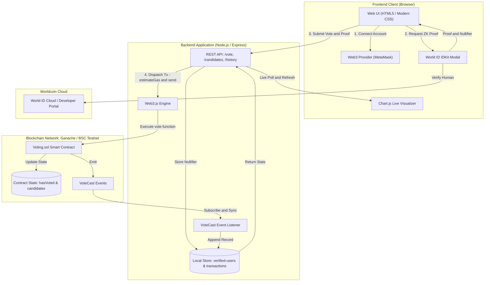
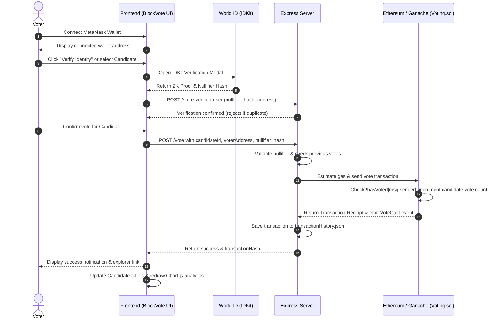

# 🗳️ BlockVote - Decentralized Blockchain Voting DApp


A secure, tamper-proof, and decentralized voting application (DApp) that combines **Ethereum smart contracts**, **World ID zero-knowledge identity verification (Sybil resistance)**, and a **real-time analytics dashboard** to ensure transparent, authentic elections.

---

## 📋 Table of Contents

- [Overview & Key Features](#-overview--key-features)
- [System Architecture & Design](#-system-architecture--design)
  - [High-Level Architecture](#high-level-architecture)
  - [Voting & Verification Workflow](#voting--verification-workflow)
  - [Smart Contract Design](#smart-contract-design)
- [Project Structure](#-project-structure)
- [Tech Stack](#-tech-stack)
- [Prerequisites](#-prerequisites)
- [Step-by-Step Guide to Run](#-step-by-step-guide-to-run)
  - [1. Clone and Install Dependencies](#1-clone-and-install-dependencies)
  - [2. Start Local Blockchain (Ganache)](#2-start-local-blockchain-ganache)
  - [3. Compile and Deploy Smart Contracts](#3-compile-and-deploy-smart-contracts)
  - [4. Start the Backend Server](#4-start-the-backend-server)
  - [5. Access Frontend & Configure MetaMask](#5-access-frontend--configure-metamask)
  - [6. World ID Verification Testing](#6-world-id-verification-testing)
- [Deploying to Public Testnet (BNB Smart Chain)](#-deploying-to-public-testnet-bnb-smart-chain)
- [REST API Reference](#-rest-api-reference)
- [Troubleshooting & FAQs](#-troubleshooting--faqs)
- [License & Authors](#-license--authors)

---

## 🚀 Overview & Key Features

- **Decentralized & Tamper-Proof**: Built on Ethereum smart contracts (`Voting.sol`), ensuring votes cannot be altered, forged, or deleted once recorded on-chain.
- **Sybil Resistance via World ID**: Leverages Worldcoin's World ID protocol with zero-knowledge proofs (`IDKit`), ensuring each human votes exactly once without disclosing their real-world identity.
- **Double-Voting Prevention**: Dual-layer protection using smart contract state (`hasVoted` mapping) and backend nullifier hash verification.
- **Real-Time Live Analytics**: Dynamic heartbeat chart (powered by Chart.js) visualizing incoming votes and candidate distribution with automated live polling.
- **Auditable Transaction Feed**: Complete, transparent record of all voting events, transaction hashes, timestamps, and direct links to block explorers.
- **Graceful Fallback / Test Mode**: Automatic fallback to simulated mock data if no Ethereum provider or network connection is detected, facilitating rapid frontend UI development.

---

## 📐 System Architecture & Design

### High-Level Architecture



### Voting & Verification Workflow



### Smart Contract Design

The core smart contract [`contracts/Voting.sol`](contracts/Voting.sol) is written in Solidity `^0.8.0`:

- **Data Models**:
  - `Candidate`: Struct storing candidate `name` and `voteCount`.
  - `hasVoted`: Mapping (`address => bool`) tracking whether an address has already voted.
  - `candidates`: Dynamic array of `Candidate` instances.
  - `owner`: Contract deployer address.
- **Key Functions**:
  - `constructor(string[] memory candidateNames)`: Initializes the list of candidates with initial zero vote counts.
  - `vote(uint candidateIndex)`:
    - Enforces `require(!hasVoted[msg.sender], "Already voted.")`.
    - Enforces `require(candidateIndex < candidates.length, "Invalid candidate.")`.
    - Marks `hasVoted[msg.sender] = true`.
    - Increments `candidates[candidateIndex].voteCount`.
    - Emits `VoteCast(address indexed voter, uint indexed candidateIndex)`.
  - `getNumOfCandidates()` & `totalCandidates()`: Getter functions returning the total number of registered candidates.

---

## 📁 Project Structure

```text
voting-dapp/
├── backend/                       # Backend Express API and blockchain integration
│   ├── app.js                     # Health-check Express server entrypoint
│   ├── index.js                   # Primary Express API, Web3 connector, and event synchronizer
│   ├── package.json               # Backend npm package manifest and dependencies
│   ├── transactionHistory.json    # JSON storage for confirmed on-chain vote records
│   ├── verified-users.json        # JSON storage for World ID verified nullifier hashes
│   └── voters.json                # Voter registry data
├── build/
│   └── contracts/
│       └── Voting.json            # Truffle-compiled ABI, bytecode, and deployment networks
├── contracts/
│   └── Voting.sol                 # Solidity smart contract for voting logic
├── frontend/                      # Client-side user interface
│   ├── app.js                     # Frontend orchestration (Web3, World ID, Chart.js, API)
│   ├── index.d.ts                 # TypeScript type definitions for World ID integration
│   ├── index.global.js            # Bundled client dependencies
│   ├── index.html                 # Main single-page interface & modals
│   ├── style.css                  # Dark-themed responsive glassmorphic stylesheet
│   └── WorldIDVerification.js     # World ID standalone client helper
├── migrations/
│   └── 1_deploy_voting.js         # Truffle migration deploying Voting.sol with initial candidates
├── .gitignore                     # Git ignore rules (.env, node_modules)
├── package.json                   # Root package manifest (Truffle, HDWallet Provider, etc.)
├── truffle-config.js              # Truffle network configurations (Ganache, BNB Testnet)
└── README.md                      # Project documentation
```

---

## 🛠️ Tech Stack

- **Smart Contract**: Solidity (`^0.8.0`), Truffle Suite
- **Blockchain Environments**:
  - Local: Ganache (`http://127.0.0.1:8545`)
  - Testnet: BNB Smart Chain Testnet (BSC Testnet, Chain ID 97)
- **Backend**: Node.js, Express.js, Web3.js (`web3@4.x`), CORS, Dotenv
- **Identity & Sybil Resistance**: Worldcoin World ID (`@worldcoin/idkit`, `@worldcoin/idkit-standalone`)
- **Frontend**: Vanilla JavaScript (ES6+), HTML5, CSS3, FontAwesome icons, Chart.js

---

## ⚙️ Prerequisites

Ensure you have the following installed on your system:

1. **Node.js**: `v16.x` or `v18.x` ([Download Node.js](https://nodejs.org/))
2. **npm**: Included with Node.js (`npm -v`)
3. **Truffle Suite**:
   ```bash
   npm install -g truffle
   ```
4. **Ganache** (CLI or GUI):
   ```bash
   npm install -g ganache
   ```
   *(Alternatively, use [Ganache GUI](https://trufflesuite.com/ganache/))*
5. **MetaMask**: Browser extension for Chrome, Brave, Firefox, or Edge ([MetaMask Download](https://metamask.io/))

---

## 🚀 Step-by-Step Guide to Run

### 1. Clone and Install Dependencies

Clone this repository and install both root and backend dependencies:

```bash
# Clone the repository
git clone https://github.com/your-username/voting-dapp.git
cd voting-dapp

# Install root dependencies
npm install

# Install backend dependencies
cd backend
npm install
cd ..
```

---

### 2. Start Local Blockchain (Ganache)

Launch a local Ganache instance listening on port `8545` (matching `truffle-config.js` and `backend/index.js`):

```bash
ganache -p 8545
```
*(If using the older `ganache-cli`, run `ganache-cli -p 8545`)*

> [!NOTE]
> Keep this terminal open. Note one of the generated **Private Keys** to import into MetaMask in Step 5.

---

### 3. Compile and Deploy Smart Contracts

Open a new terminal in the project root directory to compile and deploy `Voting.sol`:

```bash
# Compile smart contracts (generates artifacts in build/contracts/)
truffle compile

# Deploy contracts to local Ganache network
truffle migrate --reset
```

The migration deploys `Voting.sol` initialized with three default candidates: **Alice**, **Bob**, and **Charlie**.

---

### 4. Start the Backend Server

Start the primary Express server (`backend/index.js`), which connects to Ganache, synchronizes past events, and serves API routes as well as the frontend static files:

```bash
cd backend
node index.js
```

You should see:
```text
Initializing application...
Initializing blockchain connection...
Connected to: EthereumJS TestRPC/...
Loading contract...
Current network ID: ...
Contract initialized at 0x...
Loaded 0 past votes
Setting up VoteCast event listener...
Server running at http://localhost:3000
```

---

### 5. Access Frontend & Configure MetaMask

1. Open your browser and navigate to:
   ```
   http://localhost:3000
   ```
2. **Configure MetaMask for Local Ganache**:
   - Open MetaMask and click on the Network selection dropdown -> **Add network** -> **Add a network manually**.
   - **Network Name**: `Ganache Local`
   - **New RPC URL**: `http://127.0.0.1:8545`
   - **Chain ID**: `1337` (or `5777` depending on Ganache version; MetaMask will prompt the correct ID if different)
   - **Currency Symbol**: `ETH`
3. **Import a Test Account**:
   - In MetaMask, click **Import Account**.
   - Paste any of the private keys generated when Ganache started.
4. **Connect Wallet**:
   - Click the **Connect Wallet** button in the header. MetaMask will prompt you to connect your account.

---

### 6. World ID Verification Testing

The application uses World ID staging credentials (`app_staging_a130e78833240a7d415c250fdcbc85a6`).

1. Click **Verify Identity** (or attempt to cast a vote).
2. The World ID IDKit modal will open.
3. For testing without an Orb, open the official **[Worldcoin Simulator](https://simulator.worldcoin.org)** in another tab or on your mobile device.
4. Scan the QR code or paste the payload into the Worldcoin Simulator to generate a valid test zero-knowledge proof.
5. Once verified, cast your ballot for your preferred candidate!
6. Observe the transaction receipt, updated vote counter, and live heartbeat line chart.

---

## 🌐 Deploying to Public Testnet (BNB Smart Chain)

The project includes configuration for BNB Smart Chain Testnet (BSC Testnet) in `truffle-config.js`.

1. Create a `.env` file in the project root:
   ```env
   MNEMONIC="twelve word secret recovery phrase with testnet BNB funds"
   ```
2. Obtain testnet BNB from the [BNB Chain Faucet](https://www.bnbchain.org/en/testnet-faucet).
3. Deploy to BSC Testnet:
   ```bash
   truffle migrate --network bnbTestnet
   ```

---

## 📡 REST API Reference

The backend runs on port `3000` and exposes the following endpoints:

| Method | Endpoint | Description | Request Body / Parameters |
|---|---|---|---|
| `GET` | `/` | Serves `frontend/index.html` single-page application | None |
| `GET` | `/candidates` | Returns all registered candidates and vote counts | None |
| `GET` | `/candidate-votes` | Aggregates and returns candidate vote totals | None |
| `GET` | `/voting-history` | Returns all historical on-chain voting transactions | None |
| `POST` | `/store-verified-user` | Registers a World ID verified user nullifier hash | `{ "address": "0x...", "nullifier_hash": "0x...", "timestamp": 123456 }` |
| `POST` | `/vote` | Submits a vote on-chain via smart contract | `{ "candidateId": 0, "voterAddress": "0x...", "nullifier_hash": "0x..." }` |

---

## ❓ Troubleshooting & FAQs

### 1. `Contract not deployed on current network`
- **Cause**: The smart contract was not deployed to the network Ganache is currently running, or Ganache was restarted (wiping memory).
- **Solution**: Re-run `truffle migrate --reset` while Ganache is active, then restart `node index.js`.

### 2. `Nonce too high` / `Internal JSON-RPC error` in MetaMask
- **Cause**: Ganache was restarted and the account nonce was reset to 0, while MetaMask remembers previous transactions.
- **Solution**: In MetaMask, go to **Settings** > **Advanced** > **Clear activity tab data** (Reset Account).

### 3. World ID Verification Fails in Staging
- **Solution**: Ensure you are using the [Worldcoin Simulator](https://simulator.worldcoin.org) for staging credentials (`app_staging_...`). Real World App production scans require production credentials.

### 4. Running in Test Mode Without Blockchain
- If Ganache is not running or MetaMask is unavailable, the DApp automatically activates **Test Mode**, allowing you to preview the UI, test candidate cards, and observe mock vote increments.

---

## 📄 License

This project is licensed under the **MIT License**. See the [LICENSE](LICENSE) file for details.

---

## 👥 Authors & Acknowledgments

- **svnftny** - Original creator & maintainer
- Built with [Truffle](https://trufflesuite.com/), [Web3.js](https://web3js.org/), [Worldcoin](https://worldcoin.org/), and [Chart.js](https://www.chartjs.org/).
